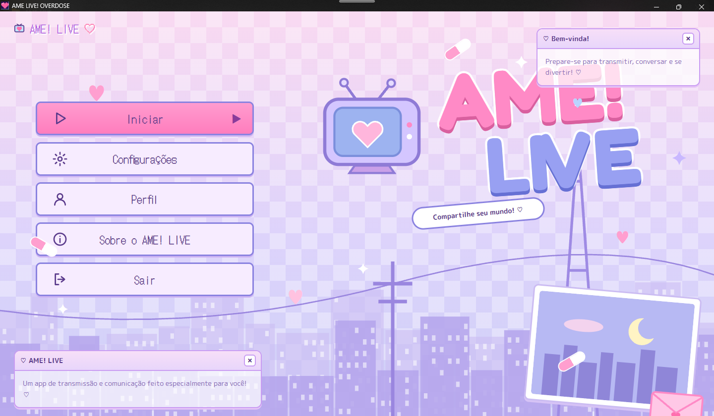
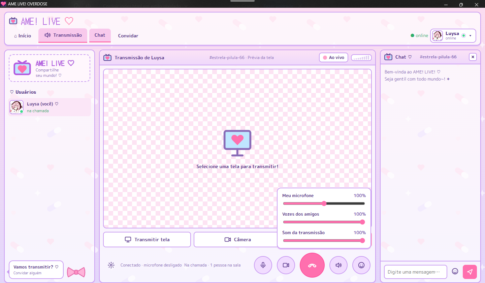
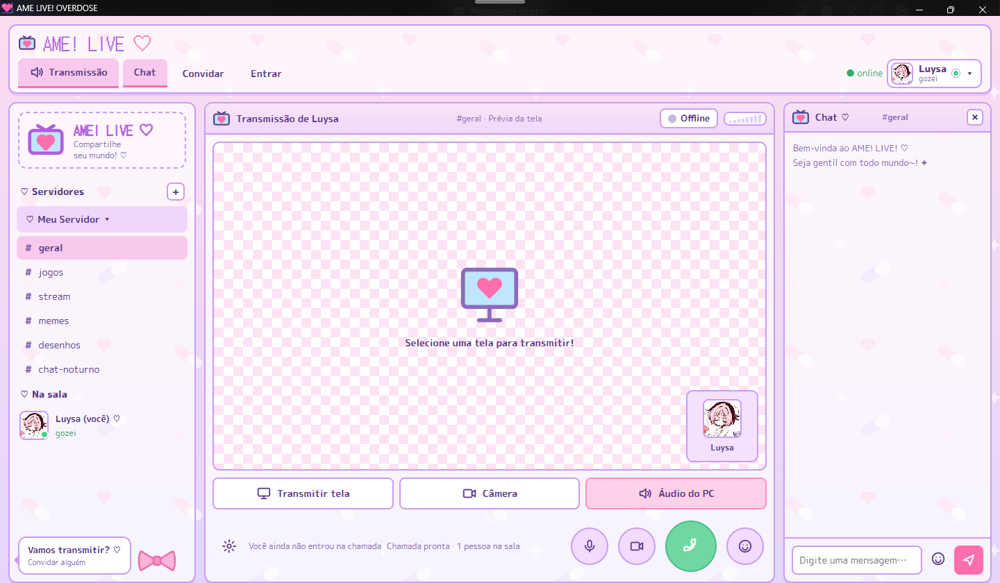
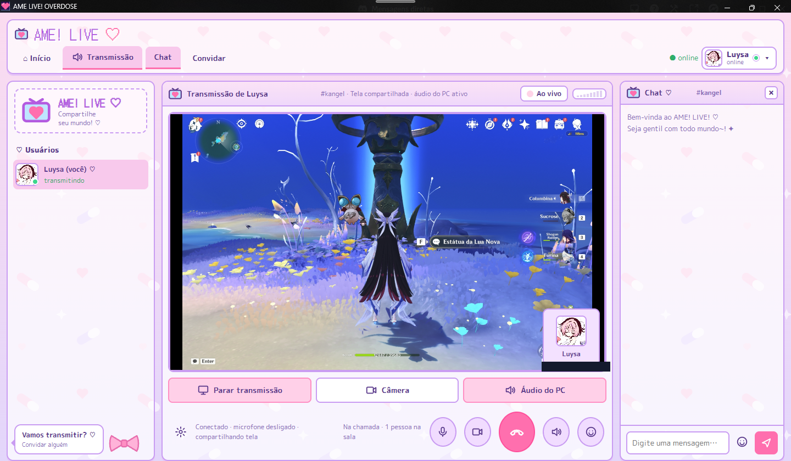

# AME! LIVE — salas, chamadas e transmissões

O AME! LIVE é um aplicativo desktop para Windows feito para reunir amigos em um espaço simples de comunicação. Crie ou entre em salas, acompanhe quem está online e converse por mensagens enquanto participa de chamadas ou compartilha o que está fazendo.

A interface combina rosa, azul e detalhes cyber-kawaii com os recursos essenciais de uma comunidade: canais de texto, lista de participantes, controles de chamada e uma área dedicada à transmissão.

### O que você encontra no app

- **Salas e canais** para organizar conversas e atividades.
- **Chat de texto** para trocar mensagens com as pessoas da sala.
- **Controles de chamada** para microfone, câmera e áudio.
- **Compartilhamento de tela** e opção de áudio do PC durante a transmissão.
- **Convites** para chamar outras pessoas para a sala.

### Capturas de tela

As imagens abaixo mostram exemplos da tela inicial, das salas e da área de transmissão.

<table>
  <tr>
    <td align="center"> Tela inicial</td>
    <td align="center"> Sala e controles de chamada</td>
  </tr>
  <tr>
    <td align="center"> Canais e participantes</td>
    <td align="center"> Transmissão ao vivo</td>
  </tr>
</table>

## Download

[**Baixar AME! LIVE para Windows — versão v1 fix**](https://github.com/Luymera/AME-LIVE-rust/releases/download/v1-fix/AME-LIVE-app-v1-fix.zip)

Baixe o ZIP e extraia **todos** os arquivos para a mesma pasta. Abra `AME LIVE.exe`; mantenha `WebView2Loader.dll` e `cloudflared.exe` ao lado dele.

Requer o Microsoft Edge WebView2 Runtime. O app pode pedir acesso à câmera e ao microfone. Ao gerar um link de convite externo, o app usa o Cloudflare Tunnel incluído no pacote; o link fica público enquanto o app estiver aberto.

O código-fonte atualizado está em `codigo-fonte/`. Para recompilar, instale Rust e execute `cargo build --release` nessa pasta. O perfil e os dados locais ficam em `%LOCALAPPDATA%\\AME-LIVE`.

O pacote inclui o Cloudflare Tunnel, distribuído sob licença Apache-2.0; consulte `LEIA-ME.txt` para os créditos.
